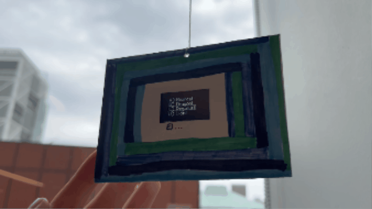
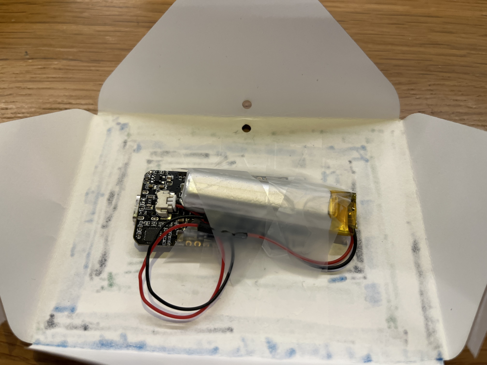

# Next Adventure

## About

**Next Adventure** is a generative art project on the theme **Transitions**. Combining random text generation, selection mechanics, and point-cloud morphing animations, the piece reflects on how personal identity can shift when moving between different schools and communities.

Developed for a LilyGO TTGO T-Display using Arduino IDE, *Next Adventure* was exhibited as part of a class installation on the fifth floor of Barnard's Milstein Center.

**[Blog Post](https://victoria3452.github.io/next-adventure.html)**

---

## Demo

[Video of full experience](https://www.youtube.com/watch?v=3XgoQcn7P28)

## Design Goals
- Reveal a quote with letters appearing in random order, materializing from darkness
- Randomly select one of four mascots, demonstrating the choice of an identity
- Seamlessly morph between mascots, visualizing transitions between identities
- Introduce a persistent fifth option, suggesting alternate possibilities

---

## Installation & Reproduction
### Hardware
- LilyGO TTGO T-Display
- USB-C cable
- Computer running Arduino IDE
### Software
- Arduino IDE
- TFT_eSPI library
- Custom mascot point-cloud headers generated from SVG artwork
### Running the Project
1) Clone this repository
2) Open transitions.ino in Arduino IDE
3) Install required dependencies
4) Connect the LilyGO TTGO T-Display
5) Upload the sketch to the device
### Installation Details
- TTGO T-Display and battery taped to back of envelope
- String tied through hole to hang up

  

Additional Notes: If you want to use different images, you can use [a photo outline tool](https://vectordad.com/photo-to-outline/#google_vignette), saving as an svg instead and use the python script: [svg_to_points](https://github.com/Victoria3452/next-adventure/blob/main/svg_to_points.py).

